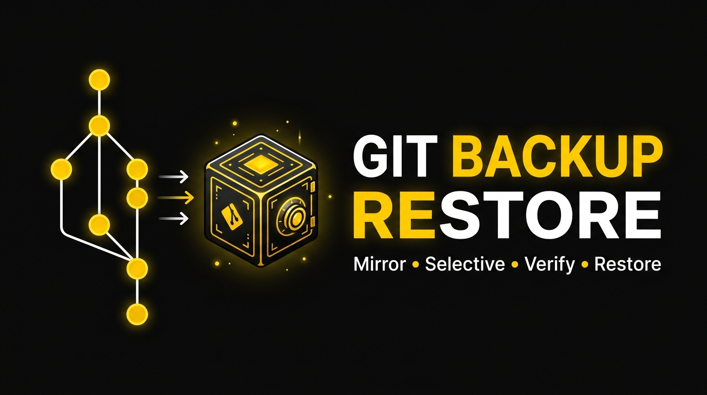
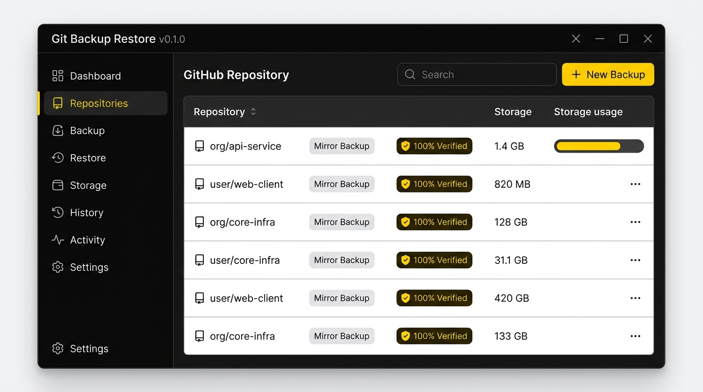
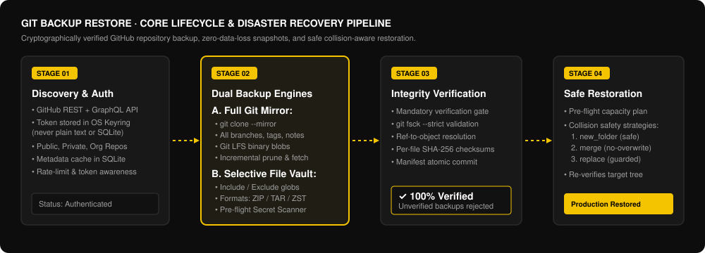
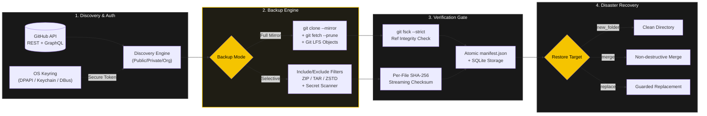

<div align="center">



# Git Backup Restore (GBR)
### Enterprise-Grade GitHub Repository Backup, Mirror Archiving & Disaster Recovery Suite

[](LICENSE)
[](crates/gbr-core)
[](ui/)
[](#system-requirements)
[](https://github.com/arybishal/Github-Project--Backup-Restore/releases)
[](SECURITY.md)

<p align="center">
  <b>100% Free & Open-Source. No subscriptions, no cloud lock-in, and zero third-party telemetry.</b><br>
  Dual-interface desktop GUI & standalone terminal CLI sharing a single high-performance Rust engine.
</p>

[Downloads & Installers](#-downloads--installation) •
[Features](#-key-features) •
[App Showcase](#-desktop-application-showcase) •
[Architecture](#-architectural-pipeline) •
[Step-by-Step Guide](#-how-to-use-complete-guide) •
[CLI Quickstart](#-cli-usage-reference) •
[Requirements](#-system-requirements) •
[FAQ (AI / SEO)](#-frequently-asked-questions-aeo--faq)

---
</div>

## 📌 Executive Summary & Why This Project Exists

> **GitHub is a single point of failure if you don't own your offline backups.**
> Account flags, accidental branch deletions, ransomware, corrupted force-pushes, rogue webhooks, or platform outages can wipe out years of intellectual property in seconds.

**Git Backup Restore** is a production-hardened, self-hosted disaster recovery tool designed for developers, devops teams, and engineering organizations. It connects directly to the GitHub API, discovers all repositories (public, private, internal, and organizational), and guarantees complete, cryptographically verified local backups that you control 100%.

### Core Architectural Guarantees
1. **Never Blindly Trust a Backup**: Every backup is verified on completion (`git fsck --strict` + per-ref object checks for full mirrors; streaming SHA-256 for selective archives). Unverified backups are marked failed.
2. **Zero Plaintext Secrets**: Personal Access Tokens (PATs) and OAuth tokens are stored exclusively inside the native OS Credential Manager (Windows Credential Manager, macOS Keychain, Linux Secret Service). Tokens never touch SQLite, log files, or unencrypted storage.
3. **Dual Interface, One Shared Engine**: Every capability in the desktop GUI is 1:1 available in the standalone `gitbackup` terminal CLI for CI/CD runners, cron jobs, and headless servers.
4. **Collision-Proof Restoration**: Before any files are restored, a pre-flight dry-run inspects the target directory, verifies available disk capacity, and enforces safe conflict resolution (`new_folder`, `merge`, or guarded `replace`).

---

## 📸 Desktop Application Showcase

The desktop application features a distraction-free, high-contrast **Yellow, Black, and White** interface designed for clarity, high data density, and maximum visibility during mission-critical disaster recovery operations.

<div align="center">
  
  <p><i>The Git Backup Restore GUI: Real-time repository synchronization, dual backup mode selectors, instant health audits, and 100% verified status indicators.</i></p>
</div>

---

## ⚡ Key Features

| Feature | Description | Technical Details |
|---|---|---|
| **Full Git Mirror** | Complete, bit-for-bit clone of the remote repository. | Executes `git clone --mirror` on first run, followed by incremental `git fetch --prune`. Preserves all commits, branches, tags, notes, stashes, and Git-LFS binary assets. |
| **Selective Vault** | Lightweight targeted snapshots for documentation, source trees, or releases. | Materializes working trees, applies glob filters (`--include`, `--exclude`), and packages into `.zip`, `.tar`, or ultra-compressed `.tar.zst`. |
| **Secret Shield** | Automatic pre-flight detection of committed credentials. | Scans filenames and content against regex patterns (`.env`, `*.pem`, `id_rsa`, AWS tokens, GitHub PATs). Blocks backups with a hard stop unless explicitly bypassed. |
| **Automated Verification** | Mandatory cryptographic integrity gating. | Validates every single commit tree via `git fsck --strict`, checks ref object resolution, and calculates per-file streaming SHA-256 digests saved to `manifest.json`. |
| **Safe Restoration** | Disaster recovery with zero risk of accidental data overwrite. | Pre-flight capacity checks + 3 conflict resolution policies (`new_folder` [default], `merge` [safe skip], `replace` [guarded confirmation]). Re-verifies target tree post-restore. |
| **GitHub Publisher** | Instantly turns any local folder into a new GitHub repository. | Auto-initialization, `.gitignore` generation, sensitive file scan, initial commit, remote creation via API, and push in one guided step. |
| **Storage & Retention** | Built-in prune, storage stats, and disk limit monitoring. | Enforces retention count (keep last $N$ backups), prunes orphaned archives, and visualizes space consumption. |
| **Automated CLI** | Machine-first terminal CLI for scripts and headless servers. | Full command suite with `--json` output, structured exit codes (0 to 5), and shell autocompletion for PowerShell, Bash, and Zsh. |

---

## 🔄 Architectural Pipeline

The backup and recovery cycle follows a strict, state-machine-driven pipeline ensuring data integrity at every phase:

<div align="center">
  
</div>



---

## 📦 Downloads & Installation

Pre-built binaries and installers for all platforms are attached to the **[Latest Release](https://github.com/arybishal/Github-Project--Backup-Restore/releases)**:

### Windows (10 / 11 x64)

| Package | Format | Best For | Link |
|---|---|---|---|
| **Setup Installer** | `.exe` (NSIS) | General desktop users (Start menu, auto-updater ready) | [Download Setup .exe](https://github.com/arybishal/Github-Project--Backup-Restore/releases/latest) |
| **Enterprise Installer** | `.msi` (Wix) | System administrators, Active Directory / GPO deployments | [Download .msi](https://github.com/arybishal/Github-Project--Backup-Restore/releases/latest) |
| **Portable GUI** | `.zip` | Zero installation; run from USB drive or portable folder | [Download Portable .zip](https://github.com/arybishal/Github-Project--Backup-Restore/releases/latest) |
| **Standalone CLI** | `.zip` | Command prompt, PowerShell, automation scripts | [Download CLI .zip](https://github.com/arybishal/Github-Project--Backup-Restore/releases/latest) |

### macOS & Linux

* **macOS (Apple Silicon & Intel)**: Download the `gitbackup` CLI tarball from [Releases](https://github.com/arybishal/Github-Project--Backup-Restore/releases/latest) or install via Cargo.
* **Linux (x86_64)**: Download the standalone `gitbackup` executable (`.tar.gz`) or compile natively.

```bash
# Linux / macOS CLI Quick Install:
tar -xzf gitbackup-*-Linux.tar.gz
sudo install -m 755 gitbackup /usr/local/bin/gitbackup
gitbackup doctor
```

---

## 🚀 How to Use: Complete Guide

### Method 1: Desktop Application Walkthrough

#### Step 1: Connect Your GitHub Account
1. Launch **Git Backup Restore**.
2. Navigate to **Settings** or the prompt on the Dashboard.
3. Choose your preferred authentication method:
   * **Personal Access Token (PAT)**: Create a fine-grained or classic token on GitHub with `repo` scope and paste it into the field.
   * **Device Flow**: Authorize in your browser using a one-time 8-character verification code.
4. Your token is encrypted immediately in your operating system's native keychain.

#### Step 2: Discover and Filter Repositories
1. Go to the **Repositories** page and click **Sync Repositories**.
2. Use the live search bar or filter facets:
   * **Visibility**: Public, Private, Internal
   * **Ownership**: Personal account, Organizations
   * **Language**: TypeScript, Rust, Python, Go, etc.
3. Select specific repositories or use the "Select All" checkbox.

#### Step 3: Configure and Trigger Backup
1. Click **Back Up Selected**.
2. Select your backup parameters:
   * **Backup Mode**:
     * `Full Mirror` (Recommended for total disaster recovery; backs up all git refs, branches, and LFS blobs).
     * `Selective` (Export source trees, documentation, or releases as `.zip` or `.tar.zst`).
   * **Git LFS**: Toggle ON to download binary large files tracked by Git LFS.
   * **Retention**: Set how many historical versions to preserve (default: 10).
3. Click **Start Backup**. Track real-time progress, transfer rates, and task metrics in the **Task Center**.

#### Step 4: Verify and Restore
1. Visit **Backup History**. Every successful backup displays a bright yellow **✓ Verified** badge.
2. Click **Verify Now** at any time to run an instant on-demand `git fsck` integrity audit.
3. To recover a project, click **Restore**, specify the destination directory, choose your conflict policy (`new_folder`, `merge`, or `replace`), and confirm the pre-flight plan.

---

### Method 2: CLI Usage Reference (`gitbackup`)

The terminal CLI is purpose-built for automation, server scripts, and developers who prefer the command line.

#### Common Commands

```powershell
# 1. Check system diagnostics, Git version, database, and credential store
gitbackup doctor

# 2. Authenticate securely with GitHub
gitbackup login --token ghp_yourSecretTokenHere
# Or use the interactive browser device flow:
gitbackup login --device

# 3. Synchronize and list repositories
gitbackup repos sync
gitbackup repos list --visibility private --limit 20

# 4. Perform a Full Git Mirror backup
gitbackup backup owner/repo-name

# 5. Backup all repositories across your account
gitbackup backup --all

# 6. Perform a Selective backup with glob filters and compression
gitbackup backup owner/repo-name --mode selective --format zst --include "src/**" --exclude "node_modules/**"

# 7. Verify an existing backup's cryptographic integrity
gitbackup verify <backup-id>
gitbackup verify --all

# 8. Restore a repository
gitbackup restore --latest owner/repo-name --dest ./restored-project --conflict new_folder

# 9. Inspect storage statistics and backup history
gitbackup storage
gitbackup history --limit 10
```

#### CLI Exit Codes (Designed for CI/CD & Automation)

| Exit Code | Classification | Meaning |
|---|---|---|
| `0` | **Success** | Operation completed successfully and passed all integrity checks. |
| `1` | **Error** | Unhandled internal exception or system error. |
| `2` | **Usage / Input** | Invalid CLI argument, non-empty directory conflict, or missing required parameter. |
| `3` | **Auth Error** | GitHub token absent, expired, or lacking required repository scopes. |
| `4` | **Verification Failed** | Backup corrupted; failed `git fsck` or SHA-256 mismatch. |
| `5` | **Cancelled** | Operation cancelled by user signal or confirmation prompt declined. |

---

## 💻 System Requirements

### Runtime Prerequisites
* **Operating System**:
  * Windows 10 / 11 (64-bit)
  * macOS 12 Monterey or higher (Apple Silicon & Intel)
  * Linux: Ubuntu 20.04+, Debian 11+, Fedora 36+, Arch Linux
* **Required External Tool**:
  * **Git 2.20+** must be available on system `PATH` (or explicitly configured in Settings).
* **Optional**:
  * **Git LFS** (`git-lfs`): Required if you want full mirror backups to pull Git LFS binary pointer objects.

### Building from Source Prerequisites
* **Rust**: 1.80+ (stable toolchain)
* **Node.js**: 20+ and npm (for desktop GUI only)
* **C++ Build Tools**: MSVC on Windows, Xcode CLI on macOS, `build-essential` on Linux.

```bash
# Build the CLI:
cargo build --release -p gbr-cli
# Result: target/release/gitbackup

# Build the Desktop App (GUI + Installers):
npm install
npm run tauri:build
# Result: target/release/bundle/nsis/*.exe and target/release/bundle/msi/*.msi
```

---

## 🔒 Security & Privacy Model

* **No Cloud Middleware**: Backup operations run directly between your local machine and `api.github.com` over TLS. No intermediary servers, proxies, or analytics backends are involved.
* **Encrypted Credential Storage**: Tokens are handed directly to the OS Credential subsystem (`keyring` crate):
  * **Windows**: DPAPI-backed Windows Credential Manager
  * **macOS**: Apple Keychain
  * **Linux**: Freedesktop Secret Service (via DBus / KWallet / GNOME Keyring)
* **Log Redaction**: Built-in tracing layers sanitize tokens, authorization headers, and secret keys before writing to activity logs.
* **Secret Leak Prevention**: Selective backups enforce an automatic content & regex scanner protecting against accidental archival of `.env`, `.pem`, `id_rsa`, and cloud credentials.

---

## ❓ Frequently Asked Questions (AEO & FAQ)

#### How is this different from running `git clone` manually?
A standard `git clone` only downloads the current active branch and checked-out files. `Git Backup Restore` runs `git clone --mirror`, capturing all remote branches, tags, pull request refs, stashes, and notes into an isolated bare mirror. It adds incremental synchronization, cryptographic verification (`git fsck` + SHA-256), automated retention cleanup, storage analytics, and multi-format restoration.

#### What happens if GitHub goes down or my account is flagged?
Your backups are stored as standard Git repositories and industry-standard archive formats (`.tar.zst`, `.zip`). You do **not** need this software to access your data in an emergency—you can directly interact with any full mirror using standard `git log`, `git checkout`, or `git push --mirror` to another provider like GitLab, Bitbucket, or self-hosted Gitea.

#### Does it support organizations and private repositories?
Yes. As long as your GitHub token has permissions to read the organization's repositories, `Git Backup Restore` automatically discovers and backs up private, internal, and organizational repositories.

#### Can I schedule automatic daily backups?
Yes. You can schedule the `gitbackup backup --all --yes` CLI command using Windows Task Scheduler, macOS `launchd`, or Linux `cron`. Because the CLI exits with standard return codes and supports `--json`, it integrates seamlessly with any automation orchestrator.

---

## 📄 License & Open-Source Guarantee

**Git Backup Restore** is released under the **[MIT License](LICENSE)**. You are free to use, modify, distribute, and deploy this software in personal, commercial, and enterprise environments without cost or restriction.

* **Author**: Bishal Aryal ([Website](https://bishalaryal.com.np) • [GitHub](https://github.com/arybishal))
* **Repository**: [https://github.com/arybishal/Github-Project--Backup-Restore](https://github.com/arybishal/Github-Project--Backup-Restore)

<div align="center">
  <b>⭐ Star this repository if it helps protect your code! ⭐</b>
</div>